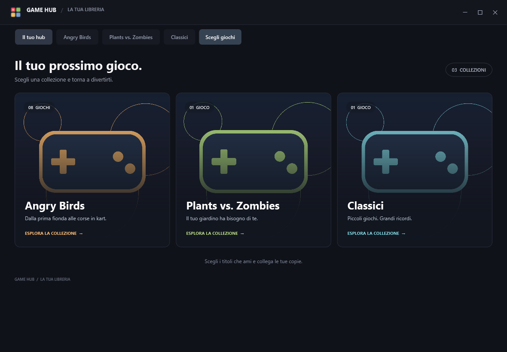
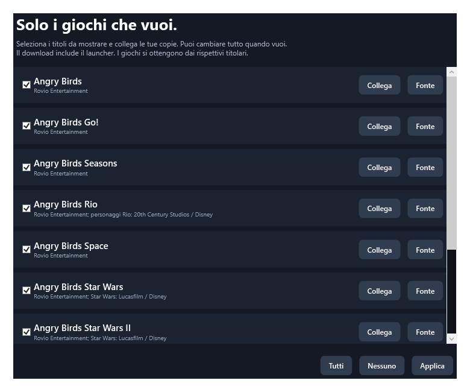

# Nostalgia Game Hub

Un piccolo launcher per Windows dedicato ai giochi che ti ricordi ancora.
Tre collezioni: **Angry Birds**, **Plants vs. Zombies** e **Classici**, con Shellrazer.



**Scegli solo i titoli che vuoi.** La prima apertura mostra una lista con caselle:
puoi escludere qualunque gioco, selezionarli tutti oppure tenere una libreria vuota.
Il pulsante **Scegli giochi** permette di cambiare selezione in qualsiasi momento.



## Scarica e usa

1. Nella pagina GitHub apri **Releases**, poi scarica **GameHub-Windows.zip**.
2. Estrai tutto lo ZIP in una cartella, quindi apri **GameHub.exe**.
3. Seleziona i giochi che vuoi vedere e premi **Applica**.
4. Sulla scheda di un titolo premi **Collega il gioco** e scegli il suo file `.exe`
   oppure il collegamento Windows `.lnk` già presente sul tuo computer.

Per un titolo Android, scegli il collegamento creato dal tuo emulatore. Il launcher
non include l'emulatore e non installa automaticamente gli APK.
**Fonte** apre una pagina ufficiale: uno store dove disponibile, altrimenti
informazioni sul titolo storico. Le pagine di titoli ritirati possono non essere più attive.

Lo ZIP è portatile e non richiede diritti amministratore. È incluso anche lo script
facoltativo `Install-Hub.ps1`, che copia il launcher nella cartella programmi del
tuo utente e crea un collegamento sul desktop. Avvialo con PowerShell solo se desideri
questa installazione; aprire direttamente GameHub.exe è sufficiente.

Windows 10/11 a 64 bit con **.NET Framework 4.8**. Il programma non è firmato con un
certificato commerciale. L'hash SHA-256 dello ZIP è nel file SHA256SUMS.txt della release.

## Quali giochi sono inclusi?

**Il download contiene il launcher, non i giochi.** Sono presenti nel catalogo:

- Angry Birds, Seasons, Rio, Space, Star Wars, Star Wars II, Go! e Bad Piggies;
- Plants vs. Zombies GOTY;
- Shellrazer.

Il launcher collega le tue copie e apre fonti ufficiali. Alcuni titoli storici non
sono più distribuiti dai rispettivi autori; non viene promesso un download disponibile
per ciascuno di essi. Leggi [crediti e diritti](CREDITS.md).

## Privacy e manutenzione

Nessun account del launcher, nessuna telemetria e nessun download in background.
Selezione e percorsi personali sono salvati solo in
`%LOCALAPPDATA%\NostalgiaGameHub\library.json`, con una copia `.bak` all'aggiornamento.
Escludere una voce la nasconde: non disinstalla il gioco e non tocca i suoi salvataggi.
Se sposti un gioco, usa **Scegli giochi → Collega** per aggiornare il percorso.
Clic destro sulla scheda per gestire collegamento, pagina ufficiale e crediti.

Per Go su BlueStacks è disponibile nei sorgenti uno [strumento facoltativo per
le copie locali dei salvataggi](docs/go-saves.md). Verifica i file prima di copiarli
e conserva le versioni precedenti; il launcher non lo avvia automaticamente.

## Compilare dai sorgenti

Da PowerShell nella cartella del progetto:

```powershell
./build.ps1 -Package
./scripts/Test-Library.ps1
```

Il compilatore C# incluso in .NET Framework crea `dist/GameHub/GameHub.exe`.
Non servono Visual Studio, Node o pacchetti NuGet. Le immagini sono già incluse;
per rigenerarle, `python scripts/prepare_assets.py` richiede Pillow.
La procedura GitHub Actions compila, verifica e conserva lo ZIP come artifact.
Un tag `v*` pubblica anche una release con ZIP e hash SHA-256; l'avvio manuale
del workflow produce soltanto l'artifact, senza una release pubblica.

Il comando `GameHub.exe --preview CARTELLA` genera anteprime delle collezioni e
della selezione senza aprire finestre né modificare il profilo normale.

## Contribuire

Per proporre un titolo aggiungi metadati, crediti e fonte ufficiale in `catalog.json`.
Usa solo asset originali o con una licenza esplicita compatibile. Non inviare giochi,
chiavi, copie modificate, salvataggi o file personali. Licenza del launcher: [MIT](LICENSE).
